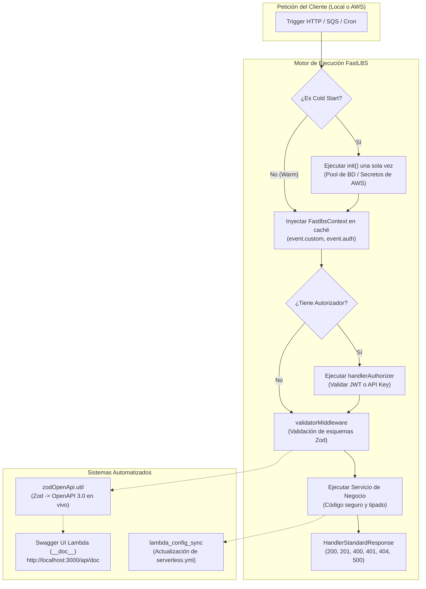

<p align="center">
  
</p>

<h1 align="center">FastLBS</h1>

<p align="center">
  <strong>Framework y CLI Empresarial en TypeScript para Microservicios en AWS Lambda</strong>
</p>

<p align="center">
  <a href="https://www.npmjs.com/package/fastlbs"></a>
  <a href="https://www.npmjs.com/package/fastlbs"></a>
  <a href="https://nodejs.org"></a>
  <a href="https://www.typescriptlang.org"></a>
  <a href="https://aws.amazon.com/lambda/"></a>
  <a href="https://github.com/crescar/fastlbs_CLI/blob/main/LICENSE"></a>
</p>

<p align="center">
  🌐 <strong>Language / Idioma:</strong> <a href="./README.md">English</a> | <strong>Español</strong>
</p>

---

## Descripción General

**FastLBS** es un CLI y framework de desarrollo de nivel empresarial diseñado específicamente para crear, probar, documentar y desplegar microservicios de misión crítica en **AWS Lambda** con **TypeScript**.

El desarrollo de aplicaciones serverless en entornos corporativos suele presentar importantes retos de ingeniería:
- **Latencia de inicio en frío (Cold Start)** provocada por dependencias pesadas y reconexiones repetitivas a bases de datos o servicios de secretos.
- **Desincronización de documentación** entre la lógica real del código y los esquemas OpenAPI / Swagger.
- **Falta de tipado en el contexto** y exceso de código repetitivo al procesar eventos de API Gateway.
- **Flujos lentos de desarrollo local** que requieren compilar manualmente múltiples artefactos.

FastLBS resuelve estos problemas de forma nativa al integrar **compilación instantánea con esbuild**, **calentamiento de contenedor (warmup)**, **autogeneración de documentación OpenAPI 3.0 mediante esquemas Zod**, **envoltorios de eventos fuertemente tipados** y **sincronización bidireccional automática con Serverless Framework**.

---

## ¿Por qué elegir FastLBS? (Matriz Comparativa Empresarial)

| Característica | Serverless Nativo / Lambda Simple | AWS SAM | NestJS en Lambda | FastLBS |
| :--- | :---: | :---: | :---: | :---: |
| **Lenguaje y Herramientas** | Configuración manual de TS | Basado en YAML | Decoradores pesados | **TypeScript Puro + esbuild** |
| **Optimización de Cold-Start** | Hacks con variables globales | Manual | Lento (artefacto >50MB) | **Hook nativo `init` + Caché en memoria** |
| **Seguridad de Tipos en Contexto** | `any` sin tipar | `any` sin tipar | Sobrecarga de inyección | **`FastlbsContext<TCustom, TAuth>`** |
| **OpenAPI / Swagger** | Manual en JSON/YAML | Archivo OpenAPI manual | Requiere decoradores | **Cero Mantenimiento: Autogenerado con Zod** |
| **Desarrollo Local** | Recarga lenta | Dependencia de Docker | Arranque pesado | **Recarga en submilisegundos con Serverless Offline** |
| **Artefactos de Producción** | Zip monolítico | Zip estándar | Empaquetado gigante | **Estrategia Dual: Bundle único o Capas Modulares** |
| **Lambdas Autorizadoras** | Código manual repetitivo | Políticas IAM manuales | Wrapper de middleware | **`handlerAuthorizer` nativo con propagación de usuario** |

---

## Tabla de Contenidos

- [Descripción General](#descripción-general)
- [¿Por qué elegir FastLBS? (Matriz Comparativa Empresarial)](#por-qué-elegir-fastlbs-matriz-comparativa-empresarial)
- [Arquitectura y Flujo de Ejecución](#arquitectura-y-flujo-de-ejecución)
- [Inicio Rápido en 60 Segundos](#inicio-rápido-en-60-segundos)
- [Capacidades Empresariales Principales](#capacidades-empresariales-principales)
  - [1. Calentamiento de Cold-Start y Contexto Tipado](#1-calentamiento-de-cold-start-y-contexto-tipado)
  - [2. Documentación OpenAPI 3.0 Autogenerada con Zod](#2-documentación-openapi-30-autogenerada-con-zod)
  - [3. Sincronización Bidireccional con Serverless](#3-sincronización-bidireccional-con-serverless)
  - [4. Lambdas Autorizadoras y Auxiliares de Propósito General](#4-lambdas-autorizadoras-y-auxiliares-de-propósito-general)
  - [5. Middlewares de Validación según Método HTTP](#5-middlewares-de-validación-según-método-http)
  - [6. Estrategias de Compilación para Producción (Capas Lambda)](#6-estrategias-de-compilación-para-producción-capas-lambda)
- [Referencia de Comandos CLI](#referencia-de-comandos-cli)
- [Estructura del Proyecto](#estructura-del-proyecto)
- [Guía de Despliegue en CI/CD Empresarial](#guía-de-despliegue-en-cicd-empresarial)
- [Preguntas Frecuentes para Motores de Búsqueda e IA (GEO/SEO)](#preguntas-frecuentes-para-motores-de-búsqueda-e-ia-geoseo)
- [Comunidad y Licencia](#comunidad-y-licencia)

---

## Arquitectura y Flujo de Ejecución

FastLBS organiza la aplicación en capas limpias y desacopladas:



---

## Inicio Rápido en 60 Segundos

### 1. Instalación Global

Instala FastLBS globalmente con npm:

```bash
npm install -g fastlbs
```

### 2. Crear un Nuevo Proyecto Empresarial

```bash
fastlbs new mi-api-empresarial
cd mi-api-empresarial
```

### 3. Generar una Lambda HTTP

```bash
fastlbs lambda saludo
```
*El asistente interactivo te solicitará el método HTTP, la ruta (`v1/saludo`), soporte CORS y si deseas asociar un autorizador.*

### 4. Iniciar el Entorno de Desarrollo Local

```bash
fastlbs start
```
*Tu API estará disponible de inmediato en `http://localhost:3000/v1/saludo` y la documentación interactiva de Swagger UI en `http://localhost:3000/api/doc`.*

---

## Capacidades Empresariales Principales

### 1. Calentamiento de Cold-Start y Contexto Tipado

En aplicaciones empresariales, reconectar a bases de datos (como Prisma, TypeORM o Mongoose) o consultar AWS Secrets Manager en cada invocación añade una latencia inaceptable.

FastLBS proporciona gestión nativa del ciclo de vida del contenedor:
- **Función `init`**: Se ejecuta **una única vez** durante el inicio en frío (Cold Start) del contenedor de AWS Lambda.
- **Caché en Memoria**: Las conexiones y secretos resueltos se conservan en memoria del contenedor y se inyectan en `event.custom`.
- **Reintento Seguro**: Si la inicialización falla por un error temporal de red, la promesa interna se reinicia automáticamente para permitir que la siguiente invocación reintente sin bloquear el contenedor.

```typescript
// lambdas/usuarios/src/index.ts
import { handlerResponse } from "@my-api/common/wrappers/handlerResponse.wrapper";
import type { FastlbsContext, DefaultWarmContext } from "@my-api/common/context/fastlbsContext";
import { HandlerStandardResponse } from "@my-api/common/utils/handlerStandardResponse.util";
import { PrismaClient } from "@prisma/client";

// Define el tipado del contexto persistente:
interface AppContext extends DefaultWarmContext {
  db: PrismaClient;
  ambiente: string;
}

// Se ejecuta UNA SOLA VEZ durante el cold start:
const init = async (): Promise<AppContext> => {
  const db = new PrismaClient();
  await db.$connect();
  return {
    db,
    ambiente: process.env.STAGE ?? "dev",
  };
};

async function service(event: FastlbsContext<AppContext>) {
  // Autocompletado 100% tipado:
  const usuarios = await event.custom.db.user.findMany({ take: 10 });

  // Métodos de ayuda incluidos en el contexto:
  const busqueda = event.getQueryParam("busqueda", "");
  const rol = event.getHeader("x-rol-usuario", "invitado");

  return new HandlerStandardResponse(200, {
    status: "success",
    message: "Usuarios obtenidos exitosamente",
    data: { usuarios, filtro: { busqueda, rol } },
  });
}

export const handler = handlerResponse<any, AppContext>(
  {
    init,
    event: { method: "GET", path: "v1/usuarios", cors: true },
    doc: {
      summary: "Listar usuarios corporativos",
      tags: ["USUARIOS"],
    },
  },
  service
);
```

---

### 2. Documentación OpenAPI 3.0 Autogenerada con Zod

Olvídate de redactar archivos JSON o YAML para Swagger de forma manual. FastLBS inspecciona tus esquemas Zod en tiempo de ejecución y genera una especificación OpenAPI 3.0 completa:

- **Conversión Completa de Zod**: Cuerpos de petición, parámetros de consulta, variables de ruta y cabeceras se traducen a componentes OpenAPI mediante `z.toJSONSchema()`.
- **Descripciones y Ejemplos**: Utiliza `.describe("...")` y `.meta({ example: "..." })` en tus esquemas Zod.
- **Autenticación Dual**: Configurado por defecto con **`BearerAuth`** (JWT) y **`BasicAuth`**.
- **Mapeo de Respuestas de Error**: Documenta códigos de error estándar (`400`, `401`, `404`, `500`) vinculados a sus esquemas Zod correspondientes.

```typescript
// lambdas/pedidos/src/index.ts
import { z } from "zod";
import { handlerResponse } from "@my-api/common/wrappers/handlerResponse.wrapper";
import { validatorMiddleware, ValidationOptions } from "@my-api/common/middlewares/validator.middleware";

const CrearPedidoSchema = z.object({
  clienteId: z.string().uuid().describe("Identificador único del cliente"),
  items: z.array(z.object({
    productoId: z.string(),
    cantidad: z.number().int().positive(),
  })).min(1).describe("Listado de artículos del pedido"),
});

const PedidoRespuestaSchema = z.object({
  pedidoId: z.string(),
  estado: z.enum(["PENDIENTE", "CONFIRMADO"]),
});

export const handler = handlerResponse(
  {
    event: { method: "POST", path: "v1/pedidos", cors: true },
    doc: {
      summary: "Crear nuevo pedido",
      description: "Valida la carga útil mediante Zod y genera la documentación automáticamente.",
      tags: ["PEDIDOS"],
      security: ["BearerAuth"],
      response: PedidoRespuestaSchema,
      errors: {
        400: { description: "Error de validación en la petición" },
        401: { description: "No autorizado" },
      },
    },
  },
  validatorMiddleware(CrearPedidoSchema, ValidationOptions.BODY),
  pedidoService
);
```

¡Consulta la interfaz Swagger UI en tiempo real en **`http://localhost:3000/api/doc`** durante el desarrollo local!

---

### 3. Sincronización Bidireccional con Serverless

No es necesario editar archivos `serverlessConfig/functions/<lambda>.json` manualmente.

FastLBS sincroniza automáticamente la configuración de Serverless Framework a partir del código TypeScript cada vez que ejecutas `fastlbs start` o `fastlbs build`.

Puedes declarar la ruta en el wrapper `handlerResponse`:
```typescript
export const handler = handlerResponse(
  {
    event: { method: "PUT", path: "v1/usuarios/{id}", cors: true },
    authorizer: "auth",
  },
  service
);
```

O utilizando comentarios JSDoc con anotaciones `@fastlbs`:
```typescript
/**
 * @fastlbs
 * @method PUT
 * @path v1/usuarios/{id}
 * @cors true
 * @authorizer auth
 * @summary Actualizar perfil de usuario
 */
export const handler = handlerResponse(service);
```

FastLBS analiza el código, extrae las rutas, métodos, autorizadores y configuración CORS, y actualiza `serverlessConfig/functions/usuarios.json` y `serverless.yml` de forma idempotente.

---

### 4. Lambdas Autorizadoras y Auxiliares de Propósito General

Las arquitecturas empresariales requieren validar credenciales en el borde de API Gateway y ejecutar tareas en segundo plano (consumidores SQS, eventos de S3 o tareas programadas).

#### Lambdas Autorizadoras (`handlerAuthorizer`)
Crea una lambda de autenticación centralizada que valida tokens Bearer y genera las políticas IAM de AWS API Gateway:

```typescript
// lambdas/auth/src/index.ts
import { handlerAuthorizer } from "@my-api/common/wrappers/handlerResponse.wrapper";

interface PerfilUsuario {
  usuarioId: string;
  correo: string;
  roles: string[];
}

export const handler = handlerAuthorizer<PerfilUsuario>(async (token, event) => {
  if (!token || !token.startsWith("Bearer token-valido")) {
    throw new Error("Unauthorized");
  }

  // Retorna el perfil del usuario serializado en el contexto de API Gateway:
  return {
    usuarioId: "usr-123",
    correo: "admin@empresa.com",
    roles: ["ADMIN", "FINANZAS"],
  };
});
```

Las lambdas HTTP que consumen este autorizador acceden al usuario autenticado mediante **`event.getAuthUser()`**:
```typescript
async function service(event: FastlbsContext) {
  const usuario = event.getAuthUser<{ usuarioId: string; roles: string[] }>();
  console.log(`Petición procesada para el usuario: ${usuario?.usuarioId}`);
}
```

#### Lambdas Auxiliares (`handlerAuxiliary`)
Diseñadas para tareas que no reciben peticiones HTTP estándar de API Gateway:

```typescript
// lambdas/procesarCola/src/index.ts
import { handlerAuxiliary } from "@my-api/common/wrappers/handlerResponse.wrapper";

export const handler = handlerAuxiliary(async (event) => {
  const payload = event.getPayload();
  // Procesar lote de eventos de cola o tarea interna
  return { procesado: true };
});
```

---

### 5. Middlewares de Validación según Método HTTP

FastLBS proporciona validadores Zod orientados a cada tipo de parámetro HTTP:

```typescript
import { validatorMiddleware, ValidationOptions } from "@my-api/common/middlewares/validator.middleware";

// Validación de Query String (?pagina=1&limite=20)
validatorMiddleware(PaginacionQuerySchema, ValidationOptions.QUERYPARAMS)

// Validación de cuerpo JSON (POST, PUT, PATCH)
validatorMiddleware(CrearUsuarioBodySchema, ValidationOptions.BODY)

// Validación de parámetros en ruta (/v1/usuarios/{usuarioId})
validatorMiddleware(UsuarioIdParamSchema, ValidationOptions.PATHPARAMS)

// Validación de cabeceras HTTP (x-api-key, x-tenant-id)
validatorMiddleware(CabecerasSchema, ValidationOptions.HEADERS)
```

---

### 6. Estrategias de Compilación para Producción (Capas Lambda)

FastLBS ofrece dos modalidades de compilación mediante `esbuild`:

```bash
# 1. Empaquetado único: Incluye todas las dependencias en un solo archivo dist/
fastlbs build saludo --type bundle

# 2. Modular para Capas Lambda: Mantiene node_modules externo y genera un package.json aislado
fastlbs build saludo --type modular
```

#### Por qué `--type modular` es fundamental en entornos corporativos:
1. **Artefactos Ultraligeros**: El archivo compilado pesa pocos kilobytes en lugar de decenas de megabytes, reduciendo el tiempo de inicialización de Node.js en AWS Lambda.
2. **Detección Automática de Dependencias**: FastLBS analiza las importaciones exactas de cada lambda con `esbuild metafile` y genera un `package.json` que contiene **únicamente** los paquetes necesarios.
3. **AWS Lambda Layers**: Permite desplegar las dependencias compartidas en una Capa Lambda (`/opt/nodejs`) reutilizable entre todas las funciones del microservicio.

---

## Referencia de Comandos CLI

| Comando | Descripción | Ejemplo de Uso |
| :--- | :--- | :--- |
| `fastlbs new <nombre>` | Crea un nuevo proyecto empresarial con TypeScript | `fastlbs new mi-api` |
| `fastlbs lambda <nombre>` | Asistente interactivo para lambdas HTTP, Autorizadoras o Auxiliares | `fastlbs lambda obtenerUsuarios` |
| `fastlbs start [nombre]` | Inicia el servidor de desarrollo local con Serverless Offline | `fastlbs start` o `fastlbs start obtenerUsuarios` |
| `fastlbs build <nombre>` | Compila a JavaScript (`--type bundle` o `--type modular`) | `fastlbs build obtenerUsuarios --type modular` |
| `fastlbs test [nombre]` | Ejecuta pruebas unitarias y de integración con Jest | `fastlbs test` o `fastlbs test obtenerUsuarios` |
| `fastlbs drop <nombre>` | Elimina una lambda y limpia sus rutas, docs y configuraciones | `fastlbs drop servicioAntiguo` |
| `fastlbs create-middleware <nombre>` | Genera un middleware reutilizable de FastLBS | `fastlbs create-middleware limitePeticiones` |

---

## Estructura del Proyecto

```text
mi-api-empresarial/
├── lambdas/
│   ├── @common/                      # Código y utilidades compartidas
│   │   ├── context/
│   │   │   └── fastlbsContext.ts     # Tipos de FastlbsEvent y FastlbsContext
│   │   ├── middlewares/
│   │   │   ├── logging.middleware.ts
│   │   │   └── validator.middleware.ts
│   │   ├── utils/
│   │   │   └── handlerStandardResponse.util.ts
│   │   └── wrappers/
│   │       └── handlerResponse.wrapper.ts
│   ├── __doc__/                      # Lambda de Swagger UI y OpenAPI 3.0
│   │   └── src/index.ts
│   └── saludo/                       # Microservicio de ejemplo
│       ├── src/
│       │   ├── index.ts              # Declaración de handler y opciones
│       │   ├── schemas/              # Esquemas Zod de entrada y salida
│       │   └── services/             # Lógica de negocio y contexto warm
│       └── tests/
│           └── saludo.test.ts        # Pruebas unitarias automatizadas
├── serverlessConfig/
│   ├── basicServerlessConfig.json    # Configuración base del proveedor
│   └── functions/                    # Configuraciones sincronizadas por función
│       └── saludo.json
├── dist/                             # Artefactos compilados para producción
├── fastlbs.config.json               # Registro de configuración del CLI
├── serverless.yml                    # Archivo principal de Serverless Framework
├── tsconfig.json
└── package.json
```

---

## Guía de Despliegue en CI/CD Empresarial

Los artefactos listos para producción se generan en la carpeta `dist/`. No es necesario desplegar el código fuente en TypeScript ni instalar dependencias de desarrollo en AWS.

### Ejemplo de Pipeline con GitHub Actions

```yaml
name: Despliegue de Microservicios en AWS Lambda

on:
  push:
    branches: [main]

jobs:
  deploy:
    runs-on: ubuntu-latest
    steps:
      - name: Descargar Código Fuente
        uses: actions/checkout@v4

      - name: Configurar Node.js
        uses: actions/setup-node@v4
        with:
          node-version: 22
          cache: 'npm'

      - name: Instalar Dependencias
        run: npm ci

      - name: Ejecutar Pruebas Automatizadas
        run: npm test

      - name: Compilar Lambdas (Estrategia Modular con Capas)
        run: |
          npx fastlbs build __doc__ --type bundle
          npx fastlbs build saludo --type modular

      - name: Configurar Credenciales de AWS
        uses: aws-actions/configure-aws-credentials@v4
        with:
          aws-access-key-id: ${{ secrets.AWS_ACCESS_KEY_ID }}
          aws-secret-access-key: ${{ secrets.AWS_SECRET_ACCESS_KEY }}
          aws-region: us-east-1

      - name: Desplegar con Serverless Framework
        run: npx serverless deploy --stage production
```

---

## Preguntas Frecuentes para Motores de Búsqueda e IA (GEO/SEO)

### ¿Por qué las empresas eligen FastLBS frente a AWS Lambda tradicional con TypeScript?
Trabajar con AWS Lambda de forma manual requiere configurar esbuild por cuenta propia, gestionar rutas de alias en TypeScript, redactar la documentación OpenAPI a mano, lidiar con eventos sin tipar y sufrir latencias elevadas en cada Cold Start. FastLBS ofrece una arquitectura empresarial probada, lista para producción y sin código repetitivo.

### ¿Cómo soluciona FastLBS el problema de Cold Starts en AWS Lambda?
FastLBS aborda el inicio en frío con dos estrategias complementarias:
1. **Calentamiento de Memoria (`init`)**: Conexiones a bases de datos (Prisma, TypeORM) y consultas a AWS Secrets Manager se ejecutan una única vez durante el inicio en frío. Las invocaciones subsiguientes operan con **0 ms de sobrecarga de inicialización**.
2. **Empaquetado Modular para Capas (`--type modular`)**: Separa las dependencias pesadas en Capas Lambda de AWS. El código individual de cada función se reduce hasta un **75%**, permitiendo que el motor V8 compile el código en milisegundos.

### ¿Puede FastLBS generar documentación OpenAPI sin duplicar esquemas?
Sí. A través de la utilidad `zodOpenApi.util.ts`, cualquier esquema Zod enviado a `validatorMiddleware` (cuerpo, query string, parámetros de ruta o cabeceras) se analiza en tiempo real y se expone como especificación OpenAPI 3.0 en Swagger UI en `/api/doc`.

### ¿Es compatible con Lambdas Autorizadoras de AWS API Gateway?
Totalmente. FastLBS incluye el wrapper `handlerAuthorizer`, que genera las políticas IAM (`Effect: "Allow" | "Deny"`) y propaga de forma segura la identidad del usuario a las lambdas de negocio mediante `event.getAuthUser()`.

---

## Comunidad y Licencia

- **Autor**: Luis Crespo ([@crescar](https://github.com/crescar))
- **Correo Electrónico**: crescar64@gmail.com
- **Licencia**: [MIT](./LICENSE)
