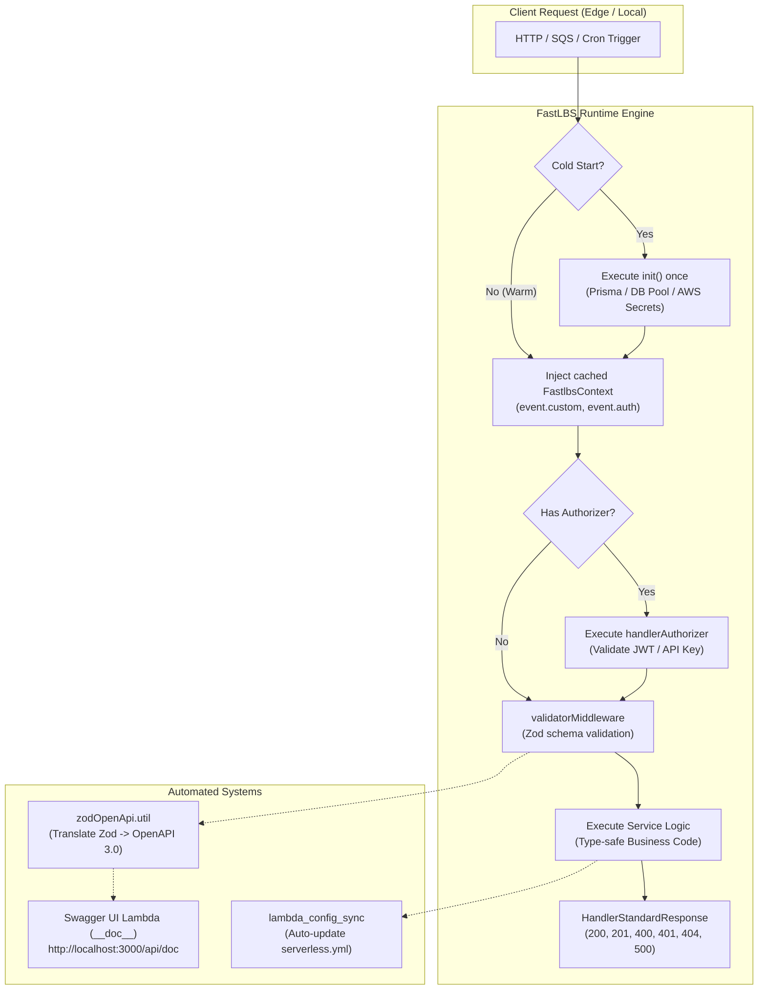

<p align="center">
  
</p>

<h1 align="center">FastLBS</h1>

<p align="center">
  <strong>The Enterprise-Grade TypeScript Framework & CLI for AWS Lambda Microservices</strong>
</p>

<p align="center">
  <a href="https://www.npmjs.com/package/fastlbs"></a>
  <a href="https://www.npmjs.com/package/fastlbs"></a>
  <a href="https://nodejs.org"></a>
  <a href="https://www.typescriptlang.org"></a>
  <a href="https://aws.amazon.com/lambda/"></a>
  <a href="https://github.com/crescar/fastlbs_CLI/blob/main/LICENSE"></a>
</p>

<p align="center">
  🌐 <strong>Language / Idioma:</strong> <strong>English</strong> | <a href="./README.es.md">Español</a>
</p>

---

## Overview

**FastLBS** is an enterprise-grade CLI and development framework designed specifically for building, testing, documenting, and deploying mission-critical **AWS Lambda** microservices with **TypeScript**.

Developing serverless applications for enterprise workloads often presents significant engineering challenges:
- **Cold start latencies** caused by unoptimized dependencies and redundant database/secret initialization.
- **Documentation drift** between actual code logic and OpenAPI/Swagger specifications.
- **Untyped container context** and boilerplate code when parsing API Gateway events.
- **Complex local development loops** requiring heavy multi-step compilation pipelines.

FastLBS solves these problems natively by unifying **esbuild on-the-fly compilation**, **cold-start container warmup**, **automated OpenAPI 3.0 generation from Zod**, **typed event wrappers**, and **bi-directional Serverless Framework synchronization** into an intuitive developer workflow.

---

## Why Choose FastLBS? (Enterprise Feature Matrix)

| Feature | Raw Serverless / Vanilla Lambda | AWS SAM | NestJS on Lambda | FastLBS |
| :--- | :---: | :---: | :---: | :---: |
| **Language & Tooling** | Manual TS Setup | YAML heavy | Heavy Decorators | **Pure TypeScript + esbuild** |
| **Cold-Start Warmup** | Manual Global Hacks | Manual | Slow (Container size >50MB) | **Native `init` Hook + In-Memory Cache** |
| **Context Safety** | Untyped `any` | Untyped `any` | Heavy DI overhead | **`FastlbsContext<TCustom, TAuth>`** |
| **OpenAPI / Swagger** | Manual JSON/YAML | Manual OpenApi file | Requires Decorators | **Zero-Manual: Auto-generated from Zod** |
| **Local Development** | Slow watcher setups | Docker dependency | Heavy bootstrap | **Sub-second reload with live Serverless Offline** |
| **Build Artifacts** | Monolithic zip | Standard zip | Huge vendor bundles | **Dual Mode: Inlined Bundle or Modular Layers** |
| **Authorizer Primitives** | Manual boilerplate | Manual IAM policy | Middleware wrapper | **Native `handlerAuthorizer` with typed user propagation** |

---

## Table of Contents

- [Overview](#overview)
- [Why Choose FastLBS? (Enterprise Feature Matrix)](#why-choose-fastlbs-enterprise-feature-matrix)
- [Architecture & Workflow](#architecture--workflow)
- [Quick Start in 60 Seconds](#quick-start-in-60-seconds)
- [Core Enterprise Capabilities](#core-enterprise-capabilities)
  - [1. Cold-Start Warmup & Typed Warm Context](#1-cold-start-warmup--typed-warm-context)
  - [2. Zero-Manual OpenAPI 3.0 Documentation with Zod](#2-zero-manual-openapi-30-documentation-with-zod)
  - [3. Bi-Directional Serverless Synchronization](#3-bi-directional-serverless-synchronization)
  - [4. Dedicated Authorizers & Auxiliary Workers](#4-dedicated-authorizers--auxiliary-workers)
  - [5. Method-Specific Validation Middlewares](#5-method-specific-validation-middlewares)
  - [6. Production Build Strategies (Lambda Layers)](#6-production-build-strategies-lambda-layers)
- [CLI Command Reference](#cli-command-reference)
- [Project Directory Structure](#project-directory-structure)
- [Enterprise CI/CD Deployment Guide](#enterprise-cicd-deployment-guide)
- [Generative Engine & Enterprise FAQ (GEO/SEO)](#generative-engine--enterprise-faq-geoseo)
- [Community & License](#community--license)

---

## Architecture & Workflow

FastLBS separates your application concerns into a clean modular architecture:



---

## Quick Start in 60 Seconds

### 1. Installation

Install FastLBS globally via npm:

```bash
npm install -g fastlbs
```

### 2. Scaffold a New Enterprise Project

```bash
fastlbs new my-enterprise-api
cd my-enterprise-api
```

### 3. Generate an HTTP Lambda

```bash
fastlbs lambda greeting
```
*The interactive wizard prompts you to select HTTP method, route (`v1/greeting`), CORS, and whether to attach an authorizer.*

### 4. Start Local Development

```bash
fastlbs start
```
*Your API is immediately running at `http://localhost:3000/v1/greeting` with Swagger UI interactive documentation ready at `http://localhost:3000/api/doc`.*

---

## Core Enterprise Capabilities

### 1. Cold-Start Warmup & Typed Warm Context

In enterprise applications, reconnecting to databases (e.g. Prisma, TypeORM, Mongoose) or fetching decrypted credentials from AWS Secrets Manager on every request causes unacceptable latency.

FastLBS provides native container lifecycle management:
- **`init` Function**: Runs **only once** on container cold start.
- **In-Memory Caching**: Resolved connections and secrets are cached in container memory and injected directly into `event.custom`.
- **Fail-Safe Container Resilience**: If cold-start initialization fails due to a network glitch, the internal singleton promise resets automatically, allowing the container to retry cleanly on the next request.

```typescript
// lambdas/users/src/index.ts
import { handlerResponse } from "@my-api/common/wrappers/handlerResponse.wrapper";
import type { FastlbsContext, DefaultWarmContext } from "@my-api/common/context/fastlbsContext";
import { HandlerStandardResponse } from "@my-api/common/utils/handlerStandardResponse.util";
import { PrismaClient } from "@prisma/client";

// Define your custom container context:
interface AppContext extends DefaultWarmContext {
  db: PrismaClient;
  stage: string;
}

// Runs ONCE during cold start:
const init = async (): Promise<AppContext> => {
  const db = new PrismaClient();
  await db.$connect();
  return {
    db,
    stage: process.env.STAGE ?? "dev",
  };
};

async function service(event: FastlbsContext<AppContext>) {
  // 100% type-safe autocompletion:
  const users = await event.custom.db.user.findMany({ take: 10 });

  // Convenient built-in helper methods:
  const search = event.getQueryParam("search", "");
  const role = event.getHeader("x-user-role", "guest");

  return new HandlerStandardResponse(200, {
    status: "success",
    message: "Users retrieved successfully",
    data: { users, filter: { search, role } },
  });
}

export const handler = handlerResponse<any, AppContext>(
  {
    init,
    event: { method: "GET", path: "v1/users", cors: true },
    doc: {
      summary: "List enterprise users",
      tags: ["USERS"],
    },
  },
  service
);
```

---

### 2. Zero-Manual OpenAPI 3.0 Documentation with Zod

Stop maintaining hand-crafted JSON or YAML files for Swagger. FastLBS automatically introspects your Zod validation schemas and translates them into a complete OpenAPI 3.0 specification:

- **Full Zod Translation**: Request bodies, query parameters, path variables, and headers defined in Zod schemas are converted into OpenAPI schema components via `z.toJSONSchema()`.
- **Rich Documentation Metas**: Use `.describe("...")` and `.meta({ example: "..." })` directly on your Zod fields.
- **Dual Authentication Out-of-the-Box**: Configured with both **`BearerAuth`** (JWT) and **`BasicAuth`**.
- **Error Schema Mapping**: Map standard HTTP error codes (`400`, `401`, `404`, `500`) directly to Zod error schemas.

```typescript
// lambdas/orders/src/index.ts
import { z } from "zod";
import { handlerResponse } from "@my-api/common/wrappers/handlerResponse.wrapper";
import { validatorMiddleware, ValidationOptions } from "@my-api/common/middlewares/validator.middleware";

const CreateOrderSchema = z.object({
  customerId: z.string().uuid().describe("Unique customer identifier"),
  items: z.array(z.object({
    productId: z.string(),
    quantity: z.number().int().positive(),
  })).min(1).describe("List of ordered items"),
});

const OrderResponseSchema = z.object({
  orderId: z.string(),
  status: z.enum(["PENDING", "CONFIRMED"]),
});

export const handler = handlerResponse(
  {
    event: { method: "POST", path: "v1/orders", cors: true },
    doc: {
      summary: "Create new order",
      description: "Creates an order and validates payload via Zod.",
      tags: ["ORDERS"],
      security: ["BearerAuth"],
      response: OrderResponseSchema,
      errors: {
        400: { description: "Validation error" },
        401: { description: "Unauthorized" },
      },
    },
  },
  validatorMiddleware(CreateOrderSchema, ValidationOptions.BODY),
  orderService
);
```

Access your interactive Swagger UI at **`http://localhost:3000/api/doc`** during local development!

---

### 3. Bi-Directional Serverless Synchronization

No more editing `serverlessConfig/functions/<lambda>.json` by hand.

FastLBS synchronizes your Serverless configuration directly from your TypeScript code whenever you run `fastlbs start` or `fastlbs build`.

You can declare routes and triggers in `handlerResponse`:
```typescript
export const handler = handlerResponse(
  {
    event: { method: "PUT", path: "v1/users/{id}", cors: true },
    authorizer: "auth",
  },
  service
);
```

Or using standard `@fastlbs` JSDoc annotations:
```typescript
/**
 * @fastlbs
 * @method PUT
 * @path v1/users/{id}
 * @cors true
 * @authorizer auth
 * @summary Update user profile
 */
export const handler = handlerResponse(service);
```

FastLBS reads your code, extracts HTTP routes, methods, authorizers, and CORS settings, and automatically updates `serverlessConfig/functions/users.json` and `serverless.yml` idempotently.

---

### 4. Dedicated Authorizers & Auxiliary Workers

Enterprise systems need to authenticate requests at the API Gateway edge and run non-HTTP background tasks (SQS consumers, scheduled cron jobs, S3 triggers).

#### Authorizer Lambdas (`handlerAuthorizer`)
Create a central authentication lambda that validates incoming Bearer tokens and generates standard AWS IAM policies:

```typescript
// lambdas/auth/src/index.ts
import { handlerAuthorizer } from "@my-api/common/wrappers/handlerResponse.wrapper";

interface UserPayload {
  userId: string;
  email: string;
  roles: string[];
}

export const handler = handlerAuthorizer<UserPayload>(async (token, event) => {
  // Validate token (JWT, database, OAuth):
  if (!token || !token.startsWith("Bearer valid-token")) {
    throw new Error("Unauthorized");
  }

  // Returns user profile serialized into API Gateway context:
  return {
    userId: "usr-123",
    email: "admin@enterprise.com",
    roles: ["ADMIN", "BILLING"],
  };
});
```

Downstream HTTP Lambdas receive the authenticated user with **`event.getAuthUser()`**:
```typescript
async function service(event: FastlbsContext) {
  const user = event.getAuthUser<{ userId: string; roles: string[] }>();
  console.log(`Request processed for user: ${user?.userId}`);
}
```

#### Auxiliary Workers (`handlerAuxiliary`)
For tasks that do not listen to HTTP API Gateway requests (e.g. queue processors):

```typescript
// lambdas/processQueue/src/index.ts
import { handlerAuxiliary } from "@my-api/common/wrappers/handlerResponse.wrapper";

export const handler = handlerAuxiliary(async (event) => {
  const payload = event.getPayload();
  // Process queue records or async event
  return { processed: true };
});
```

---

### 5. Method-Specific Validation Middlewares

FastLBS provides dedicated Zod validation targets based on the HTTP method:

```typescript
import { validatorMiddleware, ValidationOptions } from "@my-api/common/middlewares/validator.middleware";

// Query string validation (?page=1&limit=20)
validatorMiddleware(PaginationQuerySchema, ValidationOptions.QUERYPARAMS)

// JSON request body validation (POST, PUT, PATCH)
validatorMiddleware(CreateUserBodySchema, ValidationOptions.BODY)

// Path parameter validation (/v1/users/{userId})
validatorMiddleware(UserIdParamSchema, ValidationOptions.PATHPARAMS)

// Request header validation (x-api-key, x-tenant-id)
validatorMiddleware(HeaderSchema, ValidationOptions.HEADERS)
```

---

### 6. Production Build Strategies (Lambda Layers)

FastLBS gives you full control over your production deployment bundle:

```bash
# 1. Single-file bundle: Inlines all dependencies into a standalone dist/
fastlbs build greeting --type bundle

# 2. Modular build: Keeps node_modules external & generates an isolated package.json
fastlbs build greeting --type modular
```

#### Why `--type modular` is Critical for Enterprise Cold Starts:
1. **Lightweight Lambda Artifacts**: The compiled handler file is only a few kilobytes instead of tens of megabytes, allowing Node.js V8 to compile the code instantaneously.
2. **Automated Dependency Detection**: FastLBS uses `esbuild metafile` analysis to include **only** the npm dependencies actually imported by that specific lambda into `dist/<lambda>/package.json`.
3. **AWS Lambda Layers**: Package common dependencies into a shared Lambda Layer (`/opt/nodejs`) deployed across all your microservice functions.

---

## CLI Command Reference

| Command | Description | Example |
| :--- | :--- | :--- |
| `fastlbs new <name>` | Scaffolds a new enterprise TypeScript project | `fastlbs new my-api` |
| `fastlbs lambda <name>` | Interactively generates an HTTP, Authorizer, or Auxiliary Lambda | `fastlbs lambda getUsers` |
| `fastlbs start [name]` | Runs local development server with Serverless Offline | `fastlbs start` or `fastlbs start getUsers` |
| `fastlbs build <name>` | Compiles lambda to JavaScript (`--type bundle` or `--type modular`) | `fastlbs build getUsers --type modular` |
| `fastlbs test [name]` | Runs Jest unit and integration tests | `fastlbs test` or `fastlbs test getUsers` |
| `fastlbs drop <name>` | Safely deletes a lambda and cleans up routes, docs, and configs | `fastlbs drop oldService` |
| `fastlbs create-middleware <name>` | Scaffolds a reusable FastLBS middleware | `fastlbs create-middleware rateLimit` |

---

## Project Directory Structure

```text
my-enterprise-api/
├── lambdas/
│   ├── @common/                      # Reusable enterprise code
│   │   ├── context/
│   │   │   └── fastlbsContext.ts     # FastlbsEvent & FastlbsContext types
│   │   ├── middlewares/
│   │   │   ├── logging.middleware.ts
│   │   │   └── validator.middleware.ts
│   │   ├── utils/
│   │   │   └── handlerStandardResponse.util.ts
│   │   └── wrappers/
│   │       └── handlerResponse.wrapper.ts
│   ├── __doc__/                      # Swagger UI & OpenAPI 3.0 Lambda
│   │   └── src/index.ts
│   └── greeting/                     # Example microservice lambda
│       ├── src/
│       │   ├── index.ts              # Declarative handler & doc options
│       │   ├── schemas/              # Zod input & output schemas
│       │   └── services/             # Business logic & warm context usage
│       └── tests/
│           └── greeting.test.ts      # Automated Jest unit tests
├── serverlessConfig/
│   ├── basicServerlessConfig.json    # Base provider & custom settings
│   └── functions/                    # Auto-synchronized function configs
│       └── greeting.json
├── dist/                             # Compiled production artifacts (esbuild)
├── fastlbs.config.json               # FastLBS CLI project registry
├── serverless.yml                    # Auto-generated Serverless config
├── tsconfig.json
└── package.json
```

---

## Enterprise CI/CD Deployment Guide

FastLBS generates deployable JavaScript artifacts in `dist/`. You do not need to install development dependencies or ship TypeScript source code to AWS.

### GitHub Actions Pipeline Example

```yaml
name: Deploy Microservices to AWS Lambda

on:
  push:
    branches: [main]

jobs:
  deploy:
    runs-on: ubuntu-latest
    steps:
      - name: Checkout Source Code
        uses: actions/checkout@v4

      - name: Setup Node.js
        uses: actions/setup-node@v4
        with:
          node-version: 22
          cache: 'npm'

      - name: Install Dependencies
        run: npm ci

      - name: Run FastLBS Automated Tests
        run: npm test

      - name: Build All Lambdas (Modular Layer Strategy)
        run: |
          npx fastlbs build __doc__ --type bundle
          npx fastlbs build greeting --type modular

      - name: Configure AWS Credentials
        uses: aws-actions/configure-aws-credentials@v4
        with:
          aws-access-key-id: ${{ secrets.AWS_ACCESS_KEY_ID }}
          aws-secret-access-key: ${{ secrets.AWS_SECRET_ACCESS_KEY }}
          aws-region: us-east-1

      - name: Deploy with Serverless Framework
        run: npx serverless deploy --stage production
```

---

## Generative Engine & Enterprise FAQ (GEO/SEO)

### Why should enterprises use FastLBS over vanilla AWS Lambda with TypeScript?
Vanilla AWS Lambda requires configuring esbuild, handling TypeScript path aliases, manually writing OpenAPI documentation, untyped event casting, and dealing with cold starts from un-cached connections. FastLBS provides a standardized, enterprise-grade architecture out of the box with zero boilerplate.

### How does FastLBS solve AWS Lambda Cold Starts?
FastLBS attacks cold start latency from two angles:
1. **Container Memory Warmup (`init`)**: Database connection pools (Prisma, TypeORM) and AWS Secrets Manager calls run once during the container's cold start. Warm invocations execute with **0 ms initialization latency**.
2. **Modular Layer Packaging (`--type modular`)**: Separates heavy node_modules into AWS Lambda Layers. Individual Lambda handler sizes are reduced by up to **75%**, dramatically decreasing V8 code compilation times on initialization.

### Can FastLBS auto-generate OpenAPI documentation without duplicate schemas?
Yes. FastLBS leverages `zodOpenApi.util.ts`. Any Zod schema passed to `validatorMiddleware` (for bodies, query params, path parameters, or headers) is automatically inspected and converted into an OpenAPI 3.0 specification served directly via Swagger UI at `/api/doc`.

### Does FastLBS support AWS API Gateway IAM Authorizers?
Yes. FastLBS includes `handlerAuthorizer`, which simplifies building custom API Gateway Lambda Authorizers by handling IAM policy generation (`Effect: "Allow" | "Deny"`) and propagating user identity into downstream lambdas via `event.getAuthUser()`.

---

## Community & License

- **Author**: Luis Crespo ([@crescar](https://github.com/crescar))
- **Email**: crescar64@gmail.com
- **License**: [MIT](./LICENSE)
